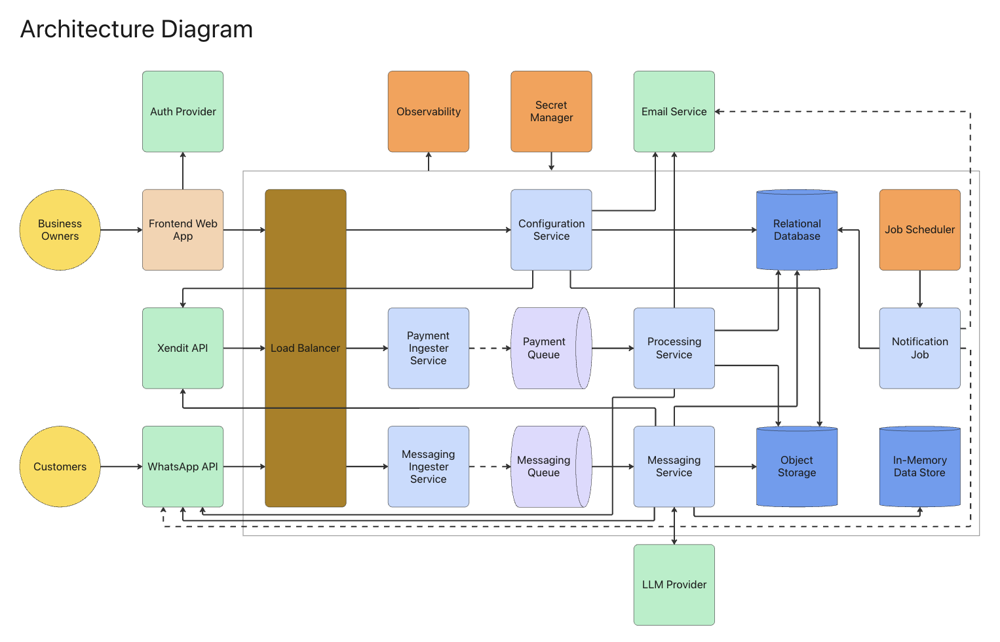

# CS5224 Project



## Running locally with Docker

```bash
docker compose up --build
RESET_DB=true docker compose up --build   # reset the database to the sample data
```

| Service | URL |
| --- | --- |
| frontend-app (Vite dev server, hot reload) | <http://localhost:5173> |
| configuration-service (Django API, Swagger at `/api/docs/`) | <http://localhost:8000> |
| payment-ingester (coming soon: port reserved) | <http://localhost:8001> |
| messaging-ingester (WhatsApp webhook → Pub/Sub, Swagger at `/docs`) | <http://localhost:8002> |
| processing-service (Gunicorn: pull consumer of the payment events, Swagger at `/docs`) | <http://localhost:8003> |
| messaging-service (Gunicorn: the chat flow behind the Chat Sandbox, LLM chat, and the pull consumer of the ingester's messages, Swagger at `/docs`) | <http://localhost:8004> |
| Ollama (the LLM, CPU only; `ollama-pull` downloads the model the first time, a few GB: `docker compose logs -f ollama-pull`) | inside Docker only (`http://ollama:11434`) |
| Pub/Sub emulator (in memory; `pubsub-init` creates the topics `whatsapp-inbound-messages` and `payment-events`) | `localhost:8085` |
| PostgreSQL | `localhost:5433` (user/password `postgres`) |

To see the WhatsApp messages the ingester published: `docker compose exec messaging-ingester python scripts/pull_debug.py`
(see `messaging-ingester/README.md`). messaging-service pulls them too, on its own subscription, and logs each one:
`docker compose logs -f messaging-service` (see `messaging-service/README.md`).

To publish dummy payment events (`payment_reference`, `status` success / fail) to the `payment-events` topic, with the stack running (by default for random orders / bookings still pending payment):

```bash
cd payment-ingester && python3 -m venv .venv && .venv/bin/pip install -r requirements.txt   # once
.venv/bin/python scripts/publish_dummy_payments.py --count 5
```

processing-service pulls them and updates those orders / bookings (payment received or failed, and the booking's calendar): `docker compose logs -f processing-service` (see `payment-ingester/README.md`).

notification-job runs every hour (cron, no port): `docker compose logs -f notification-job`. To run it once now:
`docker compose exec notification-job python run.py` (see `notification-job/README.md`).

After changing `frontend-app/package.json`, rebuild it: `docker compose up --build -V frontend-app`
(`-V` recreates the `node_modules` volume so the new packages are used).

## CI

GitHub Actions (`.github/workflows/ci.yml`) runs on every pull request to `main` and every push to `main`:

- configuration-service: checks, migrations, fixtures and tests (PostgreSQL)
- frontend-app: lint, type-check and build
- messaging-ingester, messaging-service, processing-service and notification-job: `python -m unittest` (messaging-ingester with a Pub/Sub emulator)

The ruleset in `.github/rulesets/main.json` requires the **CI passed** check (green only when every job is) before anything can be merged to `main`. To apply it: repository Settings → Rules → Rulesets → New ruleset → Import a ruleset.
